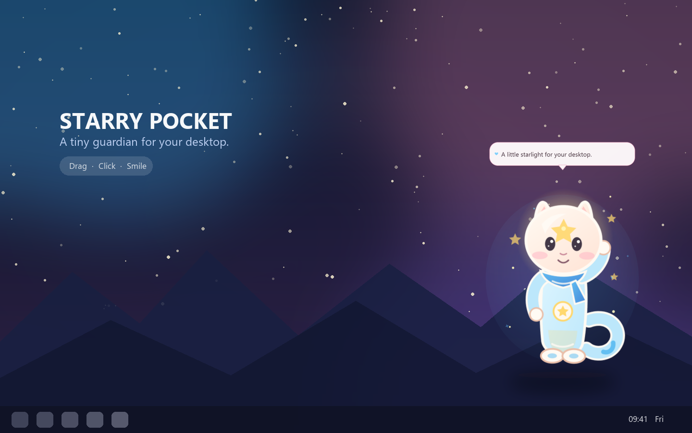
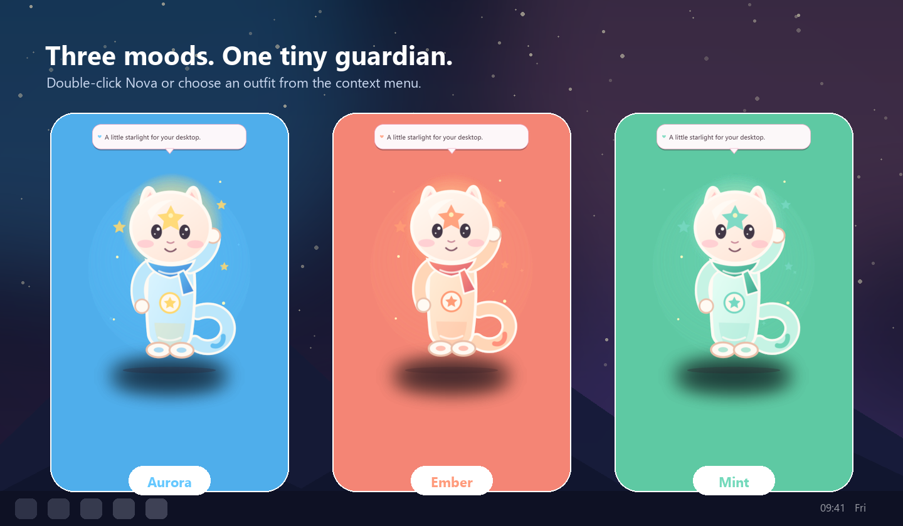
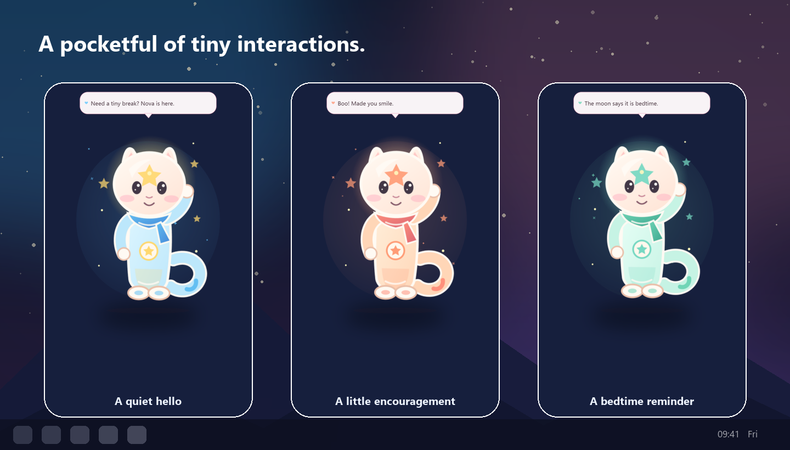

# StarryPocket

[](https://github.com/ZhuangHT-1201/StarryPocket)
[](https://www.python.org/)
[](LICENSE)

> A pocket-sized piece of starlight for your desktop.

**StarryPocket** is a cozy, always-on-top desktop companion built with Python and Qt. Meet **Nova**, a small star sprite who floats above your wallpaper, reacts to clicks, changes outfits, and occasionally reminds you to drink water or go to bed.



## Why StarryPocket?

- **Truly transparent:** Nova lives directly on your desktop with a per-pixel transparent window.
- **Alive in small ways:** breathing motion, blinking, soft particles, and context-aware messages.
- **Three outfits:** Aurora, Ember, and Mint, each with its own accent palette.
- **Made for real desktops:** drag anywhere, resize with the wheel, snap back to the corner, or hide in the tray.
- **No accounts, telemetry, or network calls:** the companion works entirely offline.
- **Privacy by design:** the repository contains original demo artwork only, never personal photos.
- **Easy to customize:** messages live in one JSON file; Nova's source artwork is editable SVG.

## Screenshots

| Three outfits | Tiny interactions |
| --- | --- |
|  |  |

All screenshots above were rendered from the real application on a synthetic wallpaper, so they contain no personal desktop or photo data.

## Controls

| Action | What happens |
| --- | --- |
| Drag Nova | Move the companion between windows and desktops |
| Click Nova | Get a tiny reaction and a pocketful of sparkles |
| Double-click Nova | Cycle through Aurora, Ember, and Mint |
| Scroll over Nova | Change her size |
| Right-click Nova | Open outfit, size, startup, and visibility controls |
| Tray icon | Left-click to show/hide, right-click for the menu |

## Quick Start

### Prebuilt Windows release

Download the latest Windows archive from the [Releases](https://github.com/ZhuangHT-1201/StarryPocket/releases) page. Extract it and run `StarryPocket.exe`.

### Run from source

```powershell
git clone https://github.com/ZhuangHT-1201/StarryPocket.git
cd StarryPocket
python -m venv .venv
.\.venv\Scripts\python.exe -m pip install -r requirements.txt
.\.venv\Scripts\python.exe main.py
```

## Privacy by Design

StarryPocket does not contain or collect personal photos. If you customize the app for yourself, keep those files outside Git:

- `private_photos/` and `photos/` are ignored by `.gitignore`.
- Common photo formats are ignored to reduce accidental uploads.
- Release builds contain only the original Nova artwork in `assets/`.
- The application has no analytics, remote logging, accounts, or upload code.

Please read [CONTRIBUTING.md](CONTRIBUTING.md) before opening a pull request.

## Customize Nova

### Change what Nova says

Edit [`messages.json`](messages.json). Messages are grouped by tap, idle, time of day, and outfit. Restart the app to load changes.

### Change Nova's look

The editable source artwork is [`assets/source/nova.svg`](assets/source/nova.svg). The renderer applies the three color variants:

```powershell
.\.venv\Scripts\python.exe -m pip install -r requirements-dev.txt
.\.venv\Scripts\python.exe tools\render_demo_assets.py
```

### Add another outfit

1. Add a color set to `VARIANTS` in `tools/render_demo_assets.py`.
2. Render the assets.
3. Add a matching entry to `POSES` and the `outfits` section of `messages.json`.

## Build a Windows Release

```powershell
.\.venv\Scripts\python.exe -m pip install -r requirements-dev.txt
powershell -ExecutionPolicy Bypass -File .\build.ps1
```

The executable and portable ZIP will appear under `dist/`.

## Project Structure

```text
StarryPocket/
├─ assets/
│  ├─ source/nova.svg      # editable mascot
│  ├─ nova_*.png           # renderer output
│  └─ icon.png / icon.ico  # app and tray icons
├─ docs/screenshots/       # privacy-safe README images
├─ tools/                  # asset renderer and screenshot generator
├─ main.py                 # Qt desktop companion
├─ messages.json           # user-editable dialogue
└─ build.ps1               # portable Windows build
```

## Contributing

Contributions are welcome through pull requests. The repository is owner-maintained and has no additional GitHub collaborators. Automated coding agents, including Cursor, are not listed as collaborators or commit co-authors.

Please keep every contribution privacy-safe: no real-person photos, local paths, usernames, tokens, logs, or screenshots of a private desktop.

## License

Released under the [MIT License](LICENSE), including the original Nova demo artwork.

Made with a little Python, a little Qt, and a pocketful of starlight.
